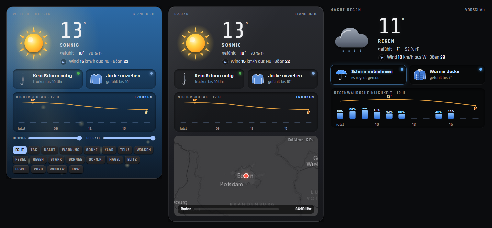

# Hallway Weather Card



*Rendered from the card code with example data (no real Home Assistant). Radar map © RainViewer / Esri.*

An animated weather card for Home Assistant, made for a hallway wall tablet: animated weather icon and
sky with weather effects, temperature, feels-like temperature, wind, an hourly rain/temperature chart,
"take an umbrella?" / "wear a jacket?" hints, an optional rain radar (DWD or RainViewer) and optional
DWD severe weather warnings.

- Card type: `custom:flur-wetter-card`
- Version: 1.4.1
- UI language: German (English translation not yet available). Option names are German and kept for compatibility.

> Built for the author's own home (Germany). Radar and warnings use the German Weather Service (DWD) by
> default; outside Germany use `radar: rainviewer` and `warnung: false`.

## Features

- Animated icon (SVG/CSS, day/night) and sky gradient with full-card effects: sun glare, stars and shooting
  stars, drifting clouds, rain (3 levels), snow, hail, fog, wind gusts with leaves, lightning, red pulsing
  border for severe weather.
- Temperature, condition, feels-like temperature (from the weather entity, otherwise calculated:
  wind chill / heat index / Steadman), humidity, wind with direction arrow and gusts.
- Umbrella and jacket hints with configurable thresholds.
- Hourly chart for the next hours: precipitation probability (or mm), temperature line, night shading.
- Optional rain radar (DWD WMS incl. 90 min forecast, or RainViewer) over an Esri dark canvas or OSM base map.
- Optional DWD warnings (WFS at the HA location, or a `dwd_weather_warnings` sensor).
- Hourly forecast via `weather.get_forecasts` / forecast subscription; the last forecast is cached in the browser
  (localStorage, max. 3 h).
- Works standalone or inside [room_panel_ha_card](https://github.com/SysriX/room_panel_ha_card): the card
  supports the panel's `rp-extcard` bridge, so its parts (`titel`, `warnung`, `jetzt`, `hinweise`, `verlauf`,
  background) can be arranged freely in the panel editor.

## Requirements

- Home Assistant 2024.1 or newer and a `weather.*` entity with hourly forecast.
- Optional: [room_panel_ha_card](https://github.com/SysriX/room_panel_ha_card) for the wall-panel layout.
- Fonts Rajdhani and Share Tech Mono are loaded from Google Fonts; the bundled "Charlie Dotted" LED font is used
  when `schrift: charlie` (default).
- Radar/warnings/base maps load data directly in the browser from `maps.dwd.de`, `api.rainviewer.com`,
  `services.arcgisonline.com` or `tile.openstreetmap.org` (only if enabled).

## Installation

### HACS (custom repository)

1. HACS → ⋮ → **Custom repositories** → add `https://github.com/SysriX/hallway_weather_ha_card`, category **Dashboard**.
2. Install **Hallway Weather Card**.
3. The resource is `/hacsfiles/hallway_weather_ha_card/hallway_weather_ha_card.js` (type *JavaScript module*).

### Manual

Copy `dist/hallway_weather_ha_card.js` **and** `dist/fonts/` into the same folder, e.g. `/config/www/raum-tablet-card/`,
and add the resource `/local/raum-tablet-card/hallway_weather_ha_card.js` (type *JavaScript module*).
The fonts are loaded from `fonts/` next to the script; override with `window.RP_FONT_BASE = '/local/…/'`.

## Configuration

```yaml
type: custom:flur-wetter-card
entity: weather.forecast_home
titel: Weather
ort: Hometown
hintergrund: himmel
radar: { quelle: dwd, zoom: 8, modus: tippen }
warnung: dwd
```

| Option | Default | Meaning |
|---|---|---|
| `entity` | – | weather entity |
| `vorhersage` | = `entity` | other weather entity used only for the hourly forecast |
| `temperatur`, `feuchte`, `wind`, `boeen` | – | outdoor sensors instead of the weather entity's values |
| `titel` / `ort` | `Wetter` / – | header title / location; both empty = no header |
| `stunden` | 12 | bars in the chart (4–24) |
| `schirm` | `{stunden: 4, prozent: 40, mm: 0.2}` | umbrella hint thresholds |
| `jacke` | `{stunden: 3, warm: 8, normal: 15, leicht: 19}` | jacket hint thresholds (feels-like °C) |
| `radar` | off | `dwd` / `rainviewer` or `{quelle, zoom, modus: tippen\|immer, vor: 60, nach: 90, ebene, karte: esri\|osm\|URL, karte_quelle}` |
| `warnung` | `dwd` | `dwd`, a `sensor.…` (dwd_weather_warnings) or `false` |
| `warnung_ab` | `Minor` | minimum level: `Minor`, `Moderate`, `Severe`, `Extreme` (or 1–4) |
| `radar_sensoren` | `auto` | DWD radar sensors used for the umbrella hint; `false` or a list |
| `hintergrund` | `himmel` | `himmel` (glass + animated sky), `glas`, `keiner`/`false` |
| `fuellen` | auto | fill width and height of the frame (auto = yes inside the room panel) |
| `layout` | auto | `breit` (480 px design) or `kompakt` (340 px) |
| `himmel_deckkraft` | 100 | sky gradient opacity in % |
| `effekte` | true with `himmel` | weather effects |
| `effekte_deckkraft` | 100 | effect strength in % |
| `animation` | true | `false` = everything static |
| `schrift` | `charlie` | `charlie` or `standard` (global: `window.RP_SCHRIFT`) |
| `ausblenden` | – | list of `hinweise`, `verlauf`, `wind`, `gefuehlt`, `warnung` |
| `vorschau` | false | test bar to preview all weather conditions, day/night, warning |
| `vorschau_zustand`, `vorschau_nacht` | – | fixed preview without the bar |

Inside the room panel with free arrangement:

```yaml
- type: card
  card:
    type: custom:flur-wetter-card
    entity: weather.forecast_home
  layout: custom
  grid: { columns: 12, row_height: 20, gap: 6, width: 340 }
  elements:
    titel:    { col: 1, row: 1, w: 12, h: 1 }
    jetzt:    { col: 1, row: 2, w: 7,  h: 6 }
    hinweise: { col: 8, row: 2, w: 5,  h: 6 }
    verlauf:  { col: 1, row: 8, w: 12, h: 6 }
```

## Fonts and licenses

- `dist/fonts/charlie_punkte.ttf`, `dist/fonts/charlie_voll.ttf`: "Charlie Dotted" by nirmalbiswas (2010, FontStruct),
  **CC BY-SA 3.0**, modified (see `dist/fonts/LIZENZ-charlie-dotted.txt`).
- Code: MIT License, see [LICENSE](LICENSE).
